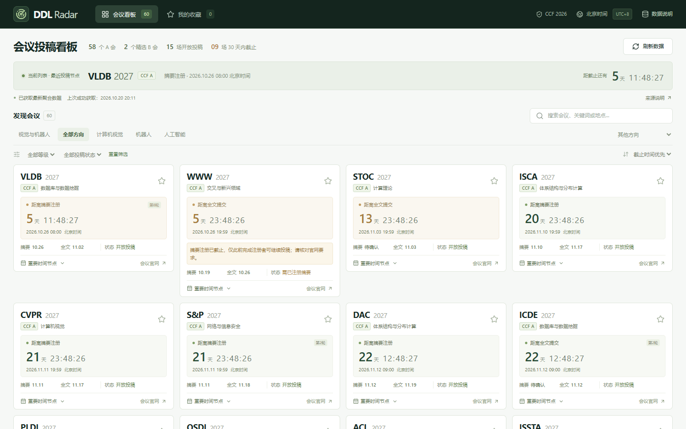

# Conference DDL Radar

简体中文 | [English](README.en.md)

一个免登录的计算机会议截止时间看板，面向计算机视觉和机器人研究者。追踪摘要、全文等重要节点，让投稿时间一目了然。

**[在线演示 →](https://conference-ddl-vision-robotics.sharpmaple1024.chatgpt.site/)**



## 功能

- **会议目录**：依据 CCF 第七版（2026）正式目录，收录全部 58 个 A 会，以及 ECCV、ICRA 两个精选 B 会。
- **截止倒计时**：按秒更新，显示北京时间并保留原始时区，支持 AoE 和有夏令时的地区。
- **重要时间节点**：摘要、全文、补充材料、作者回复、结果通知及会议举办时间；不同届次和投稿轮次分别显示。
- **搜索和筛选**：按名称、关键词、地点、年份、研究方向、CCF 等级及投稿状态筛选。
- **本地收藏**：无需账号，收藏保存在当前浏览器，不上传、不跨设备同步。
- **快速打开**：先展示真实数据快照或较新的本机缓存，再获取最新聚合记录；更新失败保留已有数据。
- **紧凑布局**：顶部导航、居中内容；宽屏每行四个会议，按窗口宽度缩为三列、两列或单列。

## 本地运行

需要 Node.js **22.13 或更高版本**，以及 npm。

```bash
git clone https://github.com/HuNeedHelp/conference-ddl-radar.git
cd conference-ddl-radar
npm ci
npm run dev
```

打开终端显示的地址，默认是 `http://127.0.0.1:5173/`。本地运行无需 API Key、数据库或 GitHub 登录。

```bash
npm test           # 时间、投稿状态与数据匹配测试
npm run typecheck  # TypeScript 检查
npm run build      # 生产构建
```

Windows 上也可直接使用 `node scripts/run-framework.mjs dev` 启动，构建时将 `dev` 改为 `build`。

## 实现

| 部分 | 技术 |
| --- | --- |
| 页面与交互 | React、TypeScript、CSS Grid |
| 应用构建 | Vinext、Vite |
| 生产运行时 | Cloudflare Workers，使用 Sites 模板的构建集成 |
| 数据解析 | js-yaml |
| 收藏与页面缓存 | 浏览器 localStorage |
| 测试 | Node.js 原生测试运行器；浏览器验证使用 Playwright |

```text
app/page.tsx                  页面、筛选和收藏
app/api/conferences/route.ts   只读数据接口
lib/data.ts                   获取聚合数据、缓存和备用源
lib/conferences.ts            会议匹配、时区与投稿状态规则
data/ccf-catalog.json         官方会议分级清单
data/source-aliases.json      官方名称与聚合记录的对应关系
data/seed.json                首屏使用的真实数据快照
tests/conferences.test.mjs    时间与领域规则测试
```

更多说明见 [架构说明](docs/architecture.md) 和 [目录来源](data/ccf-provenance.md)。

## 数据来源与更新方式

会议分级来自 [CCF 正式目录](https://www.ccf.org.cn/Academic_Evaluation/By_category/)，截止日期来自 [CCF-Deadlines](https://github.com/ccfddl/ccf-deadlines) 的公开聚合记录。

- 页面打开时请求 `/api/conferences`；服务端最多复用两分钟内的记录，手动刷新重新访问上游。备用源在主源不可用时启用。
- “上次成功获取”是读取聚合源的时间，**不代表官网逐项核验时间**。官网变化可能尚未同步到聚合源。
- 未公布、没有明确时分或无法解析时区的日期，不生成精确倒计时，也不使用历史日期推测下一届 DDL。
- 摘要注册已截止但全文尚未截止时，明确提示投稿资格前提。结果通知和会议举办时间不会作为投稿截止机会。
- 会议名称和所属领域同时参与匹配，避免两个不同领域的 FSE 等同名会议被混淆。
- CCF 分级按目录版本维护，不使用聚合源的等级覆盖正式目录。

### 更新首屏快照

将聚合源 `https://ccfddl.com/conference/allconf.yml` 下载到 `work/allconf.yml`（该目录已被 Git 忽略），然后运行：

```bash
npm run snapshot
```

日常在线获取会议数据不需要重新构建；这个命令仅更新随应用提供的初始快照。

## 部署

该应用保留 Sites 模板的 `sites()` 构建集成，生产构建为 Cloudflare Workers 产物。`.openai/hosting.json` 仅保留不绑定个人站点的默认配置；部署到自己的环境时需要单独配置站点身份。

**公开 GitHub 仓库用于分发源码；在线演示由 Sites 托管，推送此仓库不会自动更新演示站点。** 原生 GitHub Pages 不能运行当前的服务端数据接口。

## 第三方声明

- CCF-Deadlines 聚合数据的原许可声明见 [third-party-notices.txt](public/third-party-notices.txt)。
- Sites 构建插件许可见 [sites-vite-plugin.LICENSE](build/sites-vite-plugin.LICENSE)。
- 模板中其余第三方声明保留在 `vendor/` 等相应目录中。
- CCF 官方 PDF 未随源码分发，可从官方链接获取。
