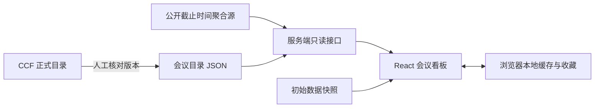

# 架构说明

Conference DDL Radar 是一个网页应用。AI 参与开发过程；网站日常运行不需要调用大模型。

## 领域结构

会议系列包含多个届次，每个届次保留其投稿轮次和重要时间节点。会议的正式 CCF 等级与聚合源中的时间记录独立维护。

`normalizeConferences` 以名称别名和所属领域共同匹配源记录，避免将同名但不同领域的会议合并。记录的年、ID、时区、原始日期、轮次和备注都会保留。

## 快速首屏与刷新

页面初始使用 `data/seed.json`，浏览器有较新且结构有效的缓存时优先采用。随后请求 `/api/conferences`，成功时替换页面数据并更新本机缓存；失败时保留已有数据并显示状态。

服务端内存缓存最多复用两分钟，同时进行的请求共享正在获取的结果。手动刷新可绕过普通缓存。主数据源失败时尝试备用镜像。

## 时间与状态

精确截止时间需要明确的日期、时分和可解析的时区。程序转换为统一时间戳，展示北京时间并保留原始值。

倒计时是截止时间戳减去浏览器当前时间，每秒重新计算，不需要每秒访问服务器。当前页面不可见时暂停走秒显示，重新可见时立即校正，并在需要时刷新聚合数据。

投稿状态区分开放投稿、需要此前注册摘要、本届已截止、时间待确认。摘要和全文按轮次对应；通知日期和会议举办日期不算作投稿截止时间。

## 保存与部署

收藏仅存储在当前浏览器 localStorage，不发送到服务端。项目不需要账号、数据库或运行时 API Key。

使用 Vinext / Vite 构建，保留 Sites 提供的 Cloudflare Workers 集成；公开仓库不包含原演示站的项目绑定、访问凭据、本地运行时目录或官方 PDF。
